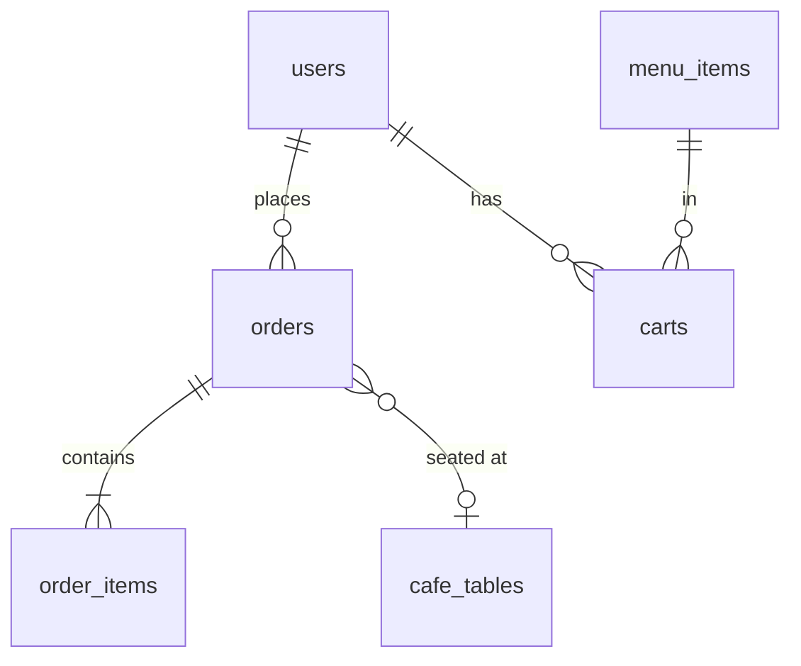

# Database guide

The project uses **SQLite**. The whole database is one file, `server/coffee-castle.db`, that the
server creates by itself. There is nothing to install or start: SQLite is built into Node.js
(the `node:sqlite` module), so you need **Node.js 22.13 or newer**. Check with `node -v`; if it is
older, install the LTS version from https://nodejs.org.

Why SQLite for this project:

- No database server to install, so every teammate can run the project in two minutes.
- It supports transactions, which is what stops two customers from getting the same table.
- The SQL you write is almost the same in PostgreSQL or MySQL, so moving later is easy (see the end).

## Getting started

1. Install the server packages:
   ```
   cd server
   npm install --legacy-peer-deps
   ```
2. Create your settings file. Copy `.env.example` to `.env`, then fill in:
   - `JWT_SECRET`: any long random text. This command makes one:
     ```
     node -e "console.log(require('crypto').randomBytes(32).toString('hex'))"
     ```
   - `ADMIN_EMAIL` and `ADMIN_PASSWORD`: the login you will use for the admin panel.
3. Start the server:
   ```
   node index.js
   ```
   (or `npm run dev` to restart automatically when you change a file)

   You will see a line saying `ExperimentalWarning: SQLite is an experimental feature`. It is
   harmless: Node prints it for every program that uses its built-in SQLite.

On the first start the server creates `server/coffee-castle.db` and fills it with:

- the tables below (all empty),
- the 6 starter menu items (the same dishes and prices as the original menu; change them in the admin panel),
- the promo banner,
- 10 cafe tables,
- one admin account, from `ADMIN_EMAIL` and `ADMIN_PASSWORD` in `.env`.

If you leave `ADMIN_PASSWORD` empty, a development admin `admin@coffeecastle.pk` / `admin12345` is
made and the server prints a warning. Never use that password on a real website.

The file is not uploaded to GitHub (it is in `.gitignore`), so **each teammate has their own
database**. Customers and orders you create on your laptop will not appear on theirs.

## Looking inside the database

- **DB Browser for SQLite** (free, https://sqlitebrowser.org): open `coffee-castle.db` and click around.
- Or the **SQLite Viewer** extension in VS Code.
- Or the command line, if you have `sqlite3`: `sqlite3 server/coffee-castle.db`

Useful queries to try:

```sql
SELECT id, name, email, role FROM users;

SELECT t.number, t.order_id, o.customer_name
FROM cafe_tables t LEFT JOIN orders o ON o.id = t.order_id;

SELECT o.id, o.customer_name, o.total, o.status, o.table_id
FROM orders o ORDER BY o.id DESC;
```

## The tables

| Table | What it holds |
| --- | --- |
| `users` | Customers and admins. `role` is `customer` or `admin`. Passwords are stored hashed (bcrypt), never as text. |
| `menu_items` | The menu: name, description, category, price, picture, `is_drink` and `sold_out` (1 = sold out). The Menu page and the admin menu form read and write this table. |
| `promo` | The home page banner. Always exactly one row (`id = 1`). |
| `cafe_tables` | The 10 tables in the cafe. `order_id` is the order sitting there now; `NULL` means free. |
| `orders` | One row per order: who, dine-in or takeaway, total, status and `table_id`. |
| `order_items` | The lines of each order. Name, drink choices (`details`, like "Large · Oat milk") and price are copied at the time of ordering, so old orders do not change when the menu does. |
| `carts` | What each logged-in customer currently has in their cart (this is what the admin sees). Only the dish, the choices and the quantity are saved: the price is worked out again by the server every time. |



## Prices are decided by the server

The browser sends only *which dish*, *which choices* (size, milk, shots, sugar, add-ons) and *how many*.
`server/menuOptions.js` works the price out from the `menu_items` table. This means nobody can change
a price by editing the page in their browser. `server/menuOptions.js` must stay the same as
`client/src/data/menuOptions.js`: if you change an option price in one, change it in the other.

## Menu items you added before the database existed

Before this version, admin-added menu items were kept in the browser's localStorage. They are **not**
copied into the database. Add them again in Admin > Menu.

## How a table is given to a customer

When a dine-in order is placed, `server/routes/orders.js` runs these steps inside one
`db.transaction(...)`: save the order, save its items, find the lowest-numbered free table, mark it
as taken, and empty the customer's cart. A transaction means all steps happen or none do, and the
server handles one order at a time, so the same table can never be given twice. If every table is
taken the order is still saved and the customer is told they are waiting. When the admin presses
**Free** on a table, it is given to the customer who has waited longest.

## Starting again from zero

Stop the server, delete these files from `server/`, and start it again:

```
coffee-castle.db
coffee-castle.db-shm
coffee-castle.db-wal
```

You get a fresh database with the starter data again. If an older test version of this project
made the file, the server will tell you to do exactly this when it starts.

## Changing the tables later

`CREATE TABLE IF NOT EXISTS` in `server/db.js` only creates tables that are missing. It does **not**
change a table that already exists. While you are developing, the easiest way to add a column is to
edit `db.js` and delete the database file as above. Once the cafe has real data, use
`ALTER TABLE ... ADD COLUMN ...` instead so nothing is lost.

## Backups

Stop the server and copy `coffee-castle.db` somewhere safe.

## If you later move to PostgreSQL or MySQL

- Replace `server/db.js` with a connection to that database. Most SQL stays the same.
- `node:sqlite` is synchronous; PostgreSQL and MySQL drivers are asynchronous, so the route
  files will need `async` / `await`.
- A hosted PostgreSQL gives the whole team one shared database. SQLite is best for one computer.
